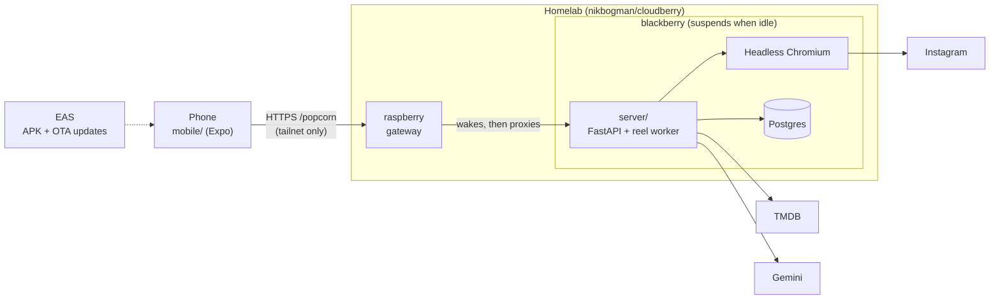

# Popcorn

A personal app for tracking the movies I watch at home. It is built for one user, who signs in with one password.

## Use cases

Terms in _italics_ are defined in [CONTEXT.md](CONTEXT.md).

| Use case | Status |
| --- | --- |
| **Movie lists** ([#1](https://github.com/nikbogman/popcorn/issues/1)): search movies by title and open one for its info. Add a movie to _To watch_, mark it _Watched_ (dated), mark a watched one _Favourite_, and browse each list. | Built |
| **Movie finder** ([#14](https://github.com/nikbogman/popcorn/issues/14)): share an Instagram reel showing a scene I don't recognise. The app reads the reel's comments, where the title is usually named, and returns the matching movie as a _Request_. | Built |
| **Explore**: discover movies beyond title search, for when I have nothing in mind. | Idea |
| **Remote control**: control playback on my home setup from the app. | Idea |
| **Movie dating**: swipe through suggestions. Right adds to _To watch_, left dismisses for now, up shows info, down hides it for good. | Idea |

## Architecture

- The app talks only to the server. Its API types are generated from the server's `openapi.json`.
- The server stores the _Collection_ and _Requests_ in Postgres and gets movie data from TMDB.
- A shared reel queues a job. The worker opens the reel in Chromium, asks Gemini for the title, then matches it on TMDB.

## Deployment

- **Server:** runs on the homelab as the `stacks/popcorn` stack, deployed from [nikbogman/cloudberry](https://github.com/nikbogman/cloudberry/blob/main/stacks/README.md#popcorn).
- **App:** built as an APK and updated over the air with EAS. There is no app store release.

## Docs

| Doc | Covers |
| --- | --- |
| [mobile/README.md](mobile/README.md) | Running the app, installing it on a phone, shipping updates |
| [server/README.md](server/README.md) | Running and testing the server, auth, the reel scraper |
| [CONTEXT.md](CONTEXT.md) | Domain terms |
| [COMMITS.md](COMMITS.md) | Commit message style |
| [designs/](designs/) | UI designs and logos |
